# Race to Feed: Event Staff Guide

> **Note:** this guide is kept up to date as features change. If a button or screen looks different from what's described here, the app has probably moved ahead of the guide. Ask the person who looks after the app.

This guide explains how to run a Race to Feed event with the app. It's organised by job, so you can skip to your part:

- [The big picture](#the-big-picture)
- [Setup before the day](#setup-before-the-day): create the event, teams and settings
- [Race control](#race-control): run the rounds on the day
- [Referees](#referees): time the teams at the tables
- [Participants](#participants): follow along on a phone
- [Projector](#projector): the big screen
- [Bitfocus Companion](#bitfocus-companion-start-and-finish-buttons): physical Start and Finish buttons
- [Ending, reopening and deleting an event](#ending-reopening-and-deleting-an-event)
- [Troubleshooting and FAQ](#troubleshooting-and-faq)

---

## The big picture

Everything happens at **https://r2f.weiss-audio.com**:

| Address | Who uses it |
|---|---|
| `r2f.weiss-audio.com` | Participants and the public, on their phones |
| `r2f.weiss-audio.com/projector` | The computer connected to the projector |
| `r2f.weiss-audio.com/ref` | Referee tablets (opened by scanning a QR code) |
| `r2f.weiss-audio.com/control` | Race control: the console, called **PRC** (setup, settings and events too) |

**A few words we use:**

- **Table:** one numbered race spot. Each team races at one table per round.
- **Station:** the table or tables one referee looks after. By default a referee covers **two tables** (1 & 2, 3 & 4, …). Race control can switch the event to **one referee per table** (see [Tables per referee](#tables-per-referee)).
- **Round:** all the races that start together on one master clock.
- **Seeding rounds:** each team races twice against the clock. Their total time ranks them within their category.
- **Brackets:** after seeding, teams are placed in brackets (Gold, Silver, Bronze, Copper, Tin, …) and race head-to-head.
- **Grand Championship:** an optional final race between the top-bracket winners of each category.

**How a round flows:**

1. Race control presses **Open round N** (the big button on the Race Control page). Everyone's phone, the projector and the referee tablets show who races at which table.
2. Each referee checks their teams are in place and presses **Ready** for each of their tables.
3. When every table is Ready, race control (or the Companion **Start** button) starts the race. The master clock runs.
4. Referees tap each team's button the moment the team finishes.
5. When every team has a time (or is marked DNF or DNS), the race finishes by itself after the auto-finish delay (30 seconds by default). Race control can press **Finish now** sooner.
6. Race control checks the results, settles any ties or penalties, and opens the next round.

> **DNF** means "did not finish" and **DNS** means "did not start". Both always rank after teams that finished.

---

## Setup before the day

Race control sets up the event before the day, then runs it. Sign in at `/control` with your email address:

1. Open `/control`. Before the console appears, a Cloudflare sign-in page (Cloudflare's own page, not the Race to Feed app) asks for your email address.
2. Type it and press the button to send a code. Wait for the email with a one-time code.
3. Type the code on the same Cloudflare page. The console opens on the **Race Control** page.

Only addresses on the console's allow list get a code. **Sign in again the day before the event** on every laptop that will run the console: a sign-in lasts 14 days on that browser, and signing in needs email, which you don't want to depend on during the event. Your email is shown in the **Log** next to everything you do.

The name at the top of the menu, **PRC**, is short for **Packing Race Coordinator**: the app that runs the race. (Race to Feed is the event; phones and the projector still show the event's name.) The console's menu on the left has these sections: **Race Control, Teams, Setup, Referees, Settings, Log**. Everyone who signs in sees all of them. Events are created, made active, ended and deleted under **Settings**. An old bookmark to the Events page opens Settings. **Sign out** (bottom of the menu) signs that browser out of Cloudflare.

If the console says **"You are not signed in. Reload this page to sign in."**, press **Reload** and sign in again. If Cloudflare or email is down on the day, use the [emergency sign-in](#troubleshooting-and-faq).

### 1. Create the event

1. Go to **Settings**. The **Events** panel is at the top of the page, open when no event is active. (Settings works even when no event is active yet.) While an event is active the panel is folded away to one line, **Events** with **Active:** and the event's name under it; click that line to open it, and click it again to fold it.
2. Type the **Event name**, pick the **Date** and enter the number of **Tables** at the venue.
3. Press **Create event**.
4. If no event is active and none has just ended, the new event becomes **Active** straight away. Otherwise, press **Make active** on its row when you're ready. (Creating next year's event right after ending this one doesn't take the champion off everyone's phones.)

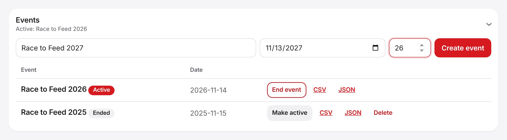

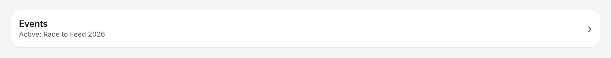

Only one event is active at a time. Older events are kept for history until you [delete them](#delete-an-event), and you can download any of them with the **CSV** or **JSON** links on its row. In the CSV, text that starts with `=`, `+`, `-` or `@` is exported with a leading apostrophe so spreadsheets show it as text instead of running it as a formula.

### 2. Add teams

Go to **Teams**.

**Import from a spreadsheet (CSV):**

1. Prepare a file with the header row `team,category`, then one team per line. For example:
   ```
   team,category
   Green Valley Students,High School
   Main Street Volunteers,Community
   ```
2. Paste it into **Paste CSV**, or press **Choose file…** to pick the file. The box already starts with the `team,category` line, so you can paste just the teams under it; pasting a list that has its own `team,category` line works too.
3. Press **Import**.

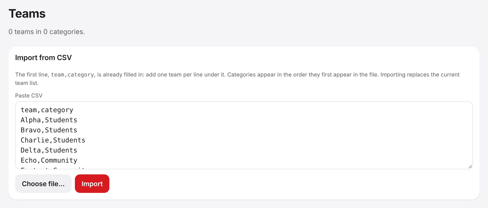

Things to know about importing:
- **Importing replaces the whole team list.** It also clears seeding groups, tables and brackets, so import first and then do the rest of setup.
- Categories appear in the order they first show up in the file.
- The order of teams in the file matters: it's the last tie-breaker in seeding.
- Category names are matched ignoring capital letters and spaces at the ends, so "High School" and "high school" are one category, while "A" and "A+" stay separate. Names in any script work.
- **Team names can be at most 35 characters**, so every name fits on one line on the projector. Shorten longer ones before importing, for example "High School" to "HS".
- If something's wrong (a missing name, a duplicate team, a name over 35 characters, a wrong header), the app lists each problem with its line number and imports nothing.

**Add, rename or remove a team:** use **Add team** (name and category) at the top, or **Rename** and **Remove** on a team's row. Adding and removing are possible only until setup is locked. Renaming works at any time. The 35-character limit applies here too. Teams already in an event with a longer name keep it until you rename them.

### 3. Seeding groups, tables and brackets

Go to **Setup** and press **Suggest groups and brackets**. The app:
- **Splits teams into seeding groups** that fit your tables (for example, 50 teams with 26 tables gives Group A with 26 and Group B with 24). It fills each group in category order, so categories stay together and only the last group is short. That last group can be much smaller (27 teams on 26 tables gives 26 and 1), so move teams between groups to even them out if you want. Each team gets a table.
- **Suggests a bracket plan** for each category, in fours (Gold, Silver, Bronze, Copper, Tin). Leftover teams join the last bracket, making it 5, 6 or 7 teams.

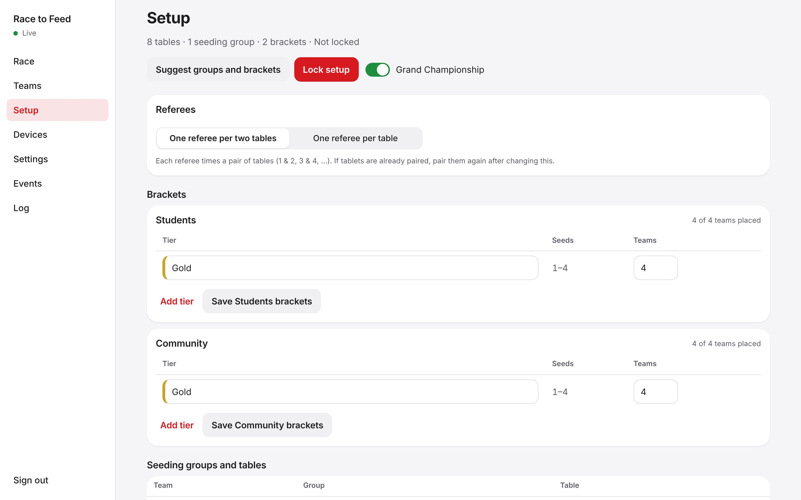

You can then adjust:
- **Seeding groups and tables:** change any team's **Group** or **Table** in the list. Two teams can't share a table in the same group.
- **Brackets:** for each category, rename a tier, change its number of teams, **Add tier** or **Remove last tier**, then press **Save [category] brackets**. The line "*X of Y teams placed*" must match before you can lock. Brackets hold 4 to 7 teams (a category with fewer than 4 teams gets one small bracket).
- **Grand Championship:** the switch turns the final race between the top-bracket winners on or off. It needs a table for every category winner, so with more categories than tables you can't lock until you add tables or turn it off.

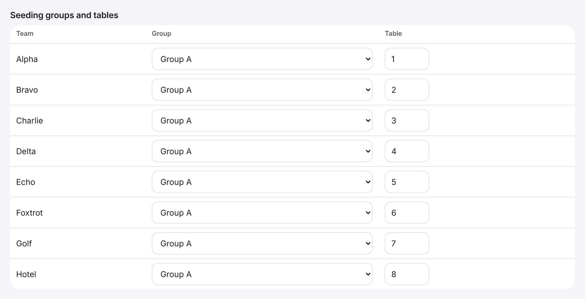

### Tables per referee

In **Setup**, under **Referees**, choose how many tables each referee covers:

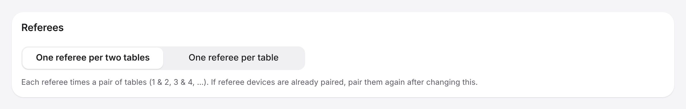

- **One referee per two tables** (the default). Each referee looks after a pair of tables.
- **One referee per table.** Each referee looks after a single table and gets one big team button. Head-to-heads are judged by two referees, both on the same master clock, so times still decide the winner.

You can change this until setup is locked. Station counts, pairing, the Ready check, the referee screen and the station labels in the console all follow the choice.

### 4. Lock the setup

When teams, groups and brackets look right, press **Lock setup** in **Setup**.

- **Locking checks everything first.** If something is wrong, you'll see a list of problems (for example, a team without a table, or brackets that don't add up, or **Grand Championship: 5 category winners but only 4 tables** when the Grand Championship is on and there are more categories than tables). Fix them and try again.
- **Racing needs a locked setup:** race control can't open a round until it's locked.
- **Unlock setup** is available only before the first round is opened.
- **Some changes still work while locked:** renaming teams, settings, the penalty list and the bag total.

### Screen links

At the bottom of **Setup**, the **Screen links** panel lists the address of every screen: participants, projector, the transparent projector for OBS, referee and race control. Press **Copy** next to one and paste it wherever it's needed (a browser, OBS, a message to a referee). Nobody has to remember or retype an address.

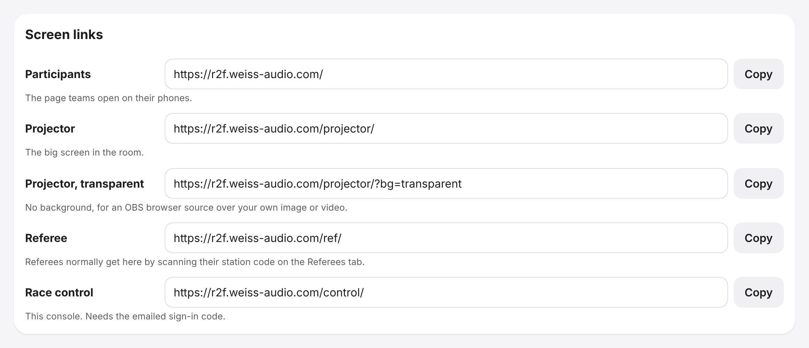

### 5. Who can sign in

The console has no password. The list of email addresses allowed to sign in is kept in Cloudflare, not in the console: whoever manages the Cloudflare account adds or removes addresses in Cloudflare's Zero Trust dashboard, on the policy of the Access application **Race to Feed console**. Ask them to add every member of race control well before the day, and have each person sign in once to check.

### 6. Companion keys

Bitfocus Companion (the Stream Deck buttons) needs a key. Under **Settings → Companion keys**:

1. Type a name, for example "Stream Deck".
2. Press **Create key**.
3. **Copy the key straight away.** It's shown only once. Press **Copy**, then **Done**.

To stop a key working, press **Revoke** next to it. See [Bitfocus Companion](#bitfocus-companion-start-and-finish-buttons) for setting up the buttons.

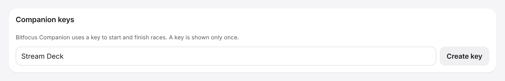

### 7. Pair the referee tablets

Go to **Referees**. There's one row per station.

1. Press **Pair tablet** on a station's row. A QR code and a short code appear.
2. On the referee's tablet or phone, scan the QR code with the camera. It opens the referee page, which asks for the referee's name; once they press **Start** the tablet is paired to that station.
3. Press **Done** to close the code.

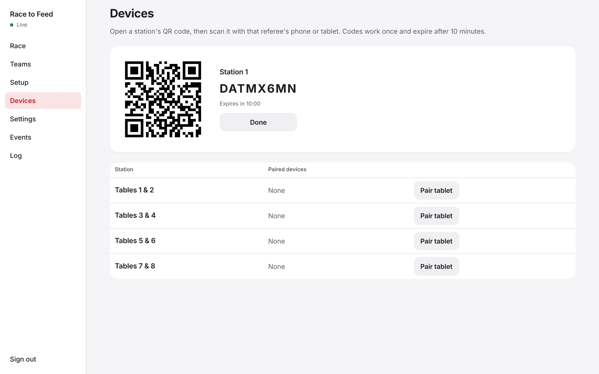

About pairing:
- **Codes are single-use and expire after 10 minutes.** Make a new one if needed.
- **One station can have more than one device**, for example a spare tablet.
- **Paired devices are listed per station** by the referee's name, with when they were last seen. **Revoke** disconnects a device immediately (for a lost tablet, say).
- **Pairing belongs to one event.** If a different event is made active, or the event is ended, tablets must be paired again.
- **With Rotate referees on, the station you pair a referee to is only where they start.** The heading reads **Starting station**, and once a round is open each referee's row also says where they are now, for example "this round: Tables 3 & 4", or "no tables this round". See [Referees on each station](#referees-on-each-station).
- **A referee paired while a round is open or running** takes the station they paired to if it has teams and no referee (so a replacement tablet can take over straight away). Otherwise they have no tables until the next round opens.

### 8. Settings

**Settings** starts with the **Events** panel (see [Create the event](#1-create-the-event)), folded away while an event is active. Below it, for the active event:

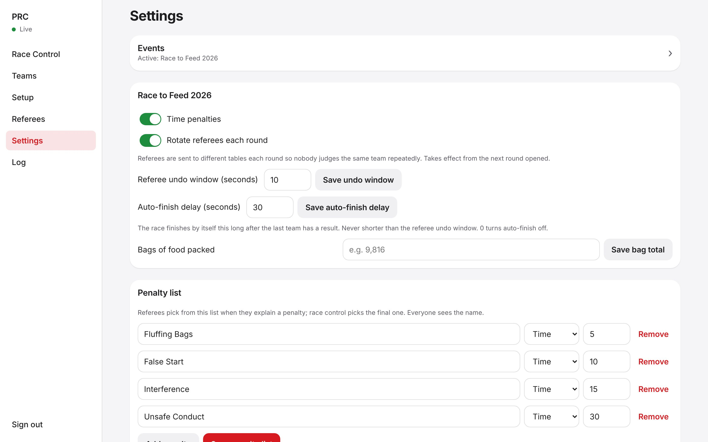

- **Time penalties:** the switch that turns referee penalties on or off for the whole event (off for a new event). See [Time penalties](#time-penalties).
- **Rotate referees each round:** on for a new event. Referees are sent to different tables each round, so nobody judges the same team again and again. It takes effect from the next round you open; the round that's open now keeps its referees. Switch it off to keep every referee at the tables they paired to. See [Referees on each station](#referees-on-each-station).
- **Referee undo window (seconds):** how long a referee can undo their own tap (default 10 seconds). Press **Save undo window**.
- **Auto-finish delay (seconds):** how long after the last team gets a result the race finishes by itself (default 30 seconds). It is never shorter than the undo window. Set it to 0 to turn auto-finish off, so only **Finish now** (or Companion's Finish) ends a race. Press **Save auto-finish delay**. See [Start and finish](#start-and-finish).
- **Bags of food packed:** the number shown on the champion screen. Type just the number (for example `9,816`) and press **Save bag total**. The screen adds "bags of food packed!". Race control can also enter it when showing the champion.
- **The penalty list:** the reasons race control chooses from when reviewing penalties. Each reason has a name and either a time (for example +10s) or **DQ** (disqualified from that race). New events start with:

  | Reason | Penalty |
  |---|---|
  | Fluffing Bags | +5s |
  | False Start | +10s |
  | Interference | +15s |
  | Unsafe Conduct | +30s |

  To change it, go to **Settings → Penalty list**. Each row has a name, **Time** or **DQ**, and the seconds for a time penalty. Use **Add penalty** and **Remove**, then press **Save penalty list**. You can change the list at any time. Each name must be different, and the list can't be empty. Penalties that were already decided keep the reason and time they were given.

  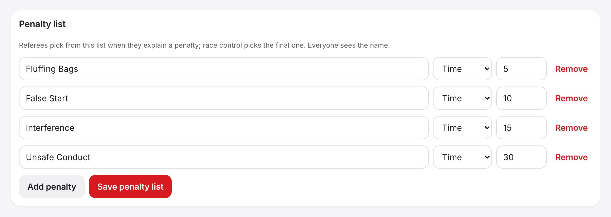

- **Appearance:** at the bottom of Settings. Choose **Automatic** (follow the computer's light or dark setting), **Light** or **Dark** for the console. It changes only the browser you're using, straight away, and is remembered there. Phones, referee tablets and the projector are not affected.

  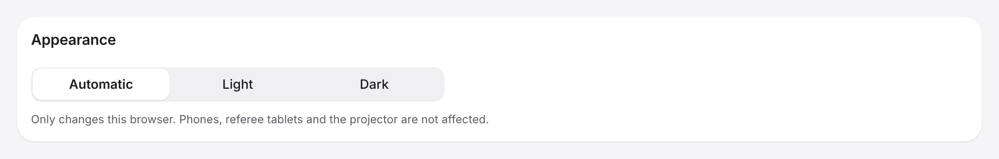

---

## Race control

Sign in at `/control` with your email address and the one-time code (see [Setup before the day](#setup-before-the-day)). Most of your work happens in the **Race Control** section.

At the top of **Race Control** you'll see:
- the round number and its state: **idle**, **open**, **running** or **finished**
- the race clock, while running
- a **status line** that says what the room is waiting for
- **one large button** that always shows the next step. It **pulses** when pressing it will work and is what you should do next. When it's greyed out, the status line says why.

| What's happening | Button | Pulses | Status line |
|---|---|---|---|
| Setup not locked yet | **Open round 1** (greyed out) | no | "Waiting on setup to be locked" |
| Between rounds, nothing blocking | **Open round N** | yes | "Ready to open round N" |
| Round open, some stations not ready | **Start** (greyed out) | no | "Waiting on N referees to be ready" |
| Round open, every station ready | **Start** | yes | "All referees ready" |
| Racing, teams still out | **Finish now** (greyed out) | no | "Racing — waiting on N teams" |
| Racing, every team has a result | **Finish now** | no | "All teams in — finishing in 23 s" (the auto-finish countdown) |
| Racing, every team in, auto-finish off | **Finish now** | yes | "All teams in" |
| Penalties still to review | **Open round N** or **Show champion** (greyed out) | no | "Waiting on N penalties to be reviewed" |
| A tie to decide | **Open round N** or **Show champion** (greyed out) | no | "Waiting on a tie to be decided" |
| A finished round has a team with no result | **Open round N** or **Show champion** (greyed out) | no | "Waiting on a missing result to be entered" |
| Last round finished | **Show champion** | yes | "Event complete" |
| Champion showing | **Hide champion** | no | "Champion is showing" |

"N referees" counts referee stations that are not Ready yet. With **one referee per table** (see [Tables per referee](#tables-per-referee)) each station is a single table, so these read "Waiting on N tables to be ready" and "All tables ready" instead. If both penalties and a tie are waiting, the status line names the penalties first.

On a device set to reduce motion, the button doesn't pulse.

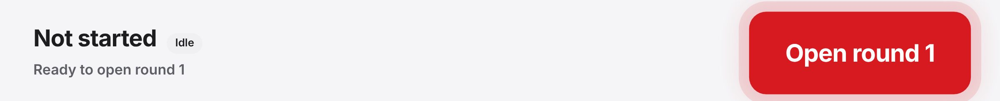

### Open a round

1. Press **Open round N**.
2. The round's tables go out to phones, the projector and the referee tablets.
3. Stations with no teams this round are marked **No teams** automatically.

**Before you open the first bracket round, check the seeding results.** Brackets become final the moment that round opens: later bracket rounds are built from those brackets, and a correction to seeding won't move a team to another bracket.

The button is greyed out while penalties, a tie or a missing result are waiting (the status line says which). If the server still refuses, the message appears under the button. It goes away by itself once the round moves on (for example, if you press **Finish now** just as auto-finish finishes the race, you won't see an error):

| Message | What to do |
|---|---|
| "Lock the setup before opening a round." | Lock the setup under **Setup**. |
| "Finish the current round first." | Finish the round that's open or running. |
| "*N* penalties need a decision first." | Decide the pending penalties (see [Penalty review](#penalty-review)). |
| "The next round is waiting on a decision." | A tie that needs deciding (see [Ties](#ties)), or a finished round where a team has no result. The Race Control page says which in red, for example "Round 3: Alpha and Delta have no result. Enter a time, DNF or DNS." |

When every round has been raced, the button reads **Show champion** and the status line says "Event complete". That's your cue to [show the champion](#show-the-champion).

### Station readiness

The **Stations** panel shows every station as **Ready**, **Not ready** or **No teams**. Referees press Ready on their tablets, one Ready per table, so a referee with two tables can ready one while the other is still setting up. Until both are ready the station reads **1 of 2 tables ready**, and it still counts as not ready. You can override any station:
- **Ready:** mark all its tables ready for the referee (for example, their tablet is having trouble).
- **Unready:** clear the Ready of all its tables. A referee can't undo their own Ready, so this is the only way.
- **Exclude:** leave the station out of the Ready check. **Include** puts it back.

While the round is open, the status line tells you how many stations are not ready yet ("Waiting on N referees to be ready", or "N tables" with one referee per table).

The room can follow along on the projector: on the **Tables** screen each team has a red dot that turns green as soon as its table is ready (the referee pressed Ready for it, or you marked the station Ready), so everyone can see which tables the start is waiting on. An excluded station's teams keep a red dot.

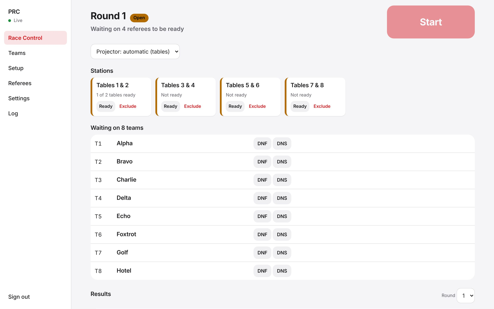

### Referees on each station

With **Rotate referees each round** switched on in **Settings** (it's on for a new event), the app decides where each referee goes when you open a round. It sends them where they've judged those teams least, and moves as few people as it can. Table assignments for teams never change; only the referees move.

- **Each station's card in the Stations panel shows its referee's name.** A referee who has to move sees "Round 5: go to Tables 7 & 8" on their tablet and presses **I'm there** when they arrive, then **Ready** as usual.
- **"No referee"** on a card means the station has teams but nobody to judge them, because fewer referees are paired than there are stations in use. The lowest-numbered stations get the referees. For the others, use your own **Ready** on the card, and **Finish**, **DNF** and **DNS** in the **Waiting on *N* teams** panel.
- **A referee with no tables** (more referees than stations in use) sees "No tables this round" and waits for the next round.
- **In a bracket's deciding race and in the Grand Championship**, if both teams are at one station and a referee is spare, the two share the station: the card shows both, for example "Dana (T1)" and "Sam (T2)", and each taps only their own team. With no spare referee the race runs as normal and a [Fairness](#fairness) warning tells you one referee judged the final.
- **Earlier rounds never change.** Who judged a round is saved when it opens.
- **The Referees page** shows where each referee is this round, next to the station they started at.

With the switch off, every referee stays at the tables they paired to, no names appear on the cards, and nothing else here applies.

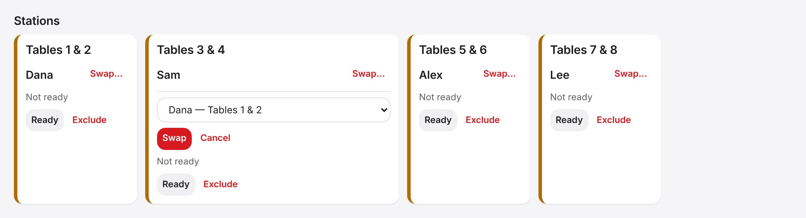

### Swap two referees

While a round is **open** (before **Start**), you can change who is where:

1. In the **Stations** panel, press **Swap…** next to a referee's name.
2. Choose the referee to change places with. The list shows where each one is now ("Lee — Tables 3 & 4"), or "no tables" for a referee with a round off.
3. Press **Swap**. Both tablets show the new tables straight away, with the "go to" notice.

Good to know:
- **Any Ready already given at those tables is cleared**, so the referees press Ready again once they've moved.
- **Choosing a referee with no tables** brings them in, and the other referee gets the round off.
- **A swap can put a referee with a team they've already judged.** That's allowed; you'll get a "Same referee, same team" note under [Fairness](#fairness).
- **Once the race has started, the Swap… buttons are gone.** Referees can't be swapped mid-race or for an earlier round.

### Start and finish

- **Start** works only when every station that has teams is Ready (or overridden). Until then it's greyed out and the status line reads, for example, "Waiting on 2 referees to be ready".
- **Finish now** works only when every team in the round has a time, DNF or DNS. Until then it's greyed out and the status line reads "Racing — waiting on *N* teams".

While a round runs, the **Waiting on *N* teams** panel lists every team without a result yet, with **Finish**, **DNF** and **DNS** buttons for each one. **Finish** stops that team's clock at the moment you press it, exactly as the referee's tap would; use it when a referee's tablet has failed or they missed the tap. If you press it by mistake, correct the time in **Results**.

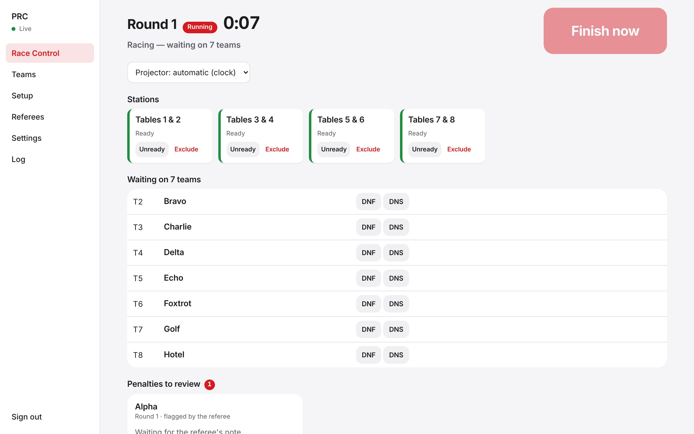

When the round finishes, the clock stops and the round's results are locked in. Referees can no longer tap or undo.

**Auto-finish:** once every team in the running round has a result, the race finishes by itself after the auto-finish delay (the **Auto-finish delay** in Settings).
- **The auto-finish delay starts again** after any later tap, penalty, undo or correction, so referees have time to add penalties after the last finish. Changing the undo window or the auto-finish delay in Settings also starts it again, with the new length.
- **It is cancelled** if a team loses its result (a referee's undo, or you press **Clear**). It starts again when every team has a result.
- **The status line counts down**: "All teams in — finishing in 23 s".
- **It finishes exactly as Finish now does**, and the **Log** shows it as "auto-finish". You can still press **Finish now** (or the Companion button) sooner.
- It keeps counting even if nobody has the console open.

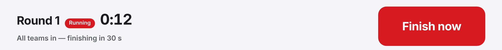

Companion's Start and Finish buttons follow exactly the same rules.

### Enter or correct results

The **Results** panel lists every team in the round, with its table, race and time. Use the **Round** menu to look at an earlier round. For each team you can:

- **Enter a time:** type it as `m:ss` or `m:ss.hh` (for example `3:41.20`) and press **Set**.
- **DNF** or **DNS:** mark the team.
- **Clear:** remove the result. In a finished round, a team left without a result holds everything up: the next round can't be opened, and the champion can't be shown, until you enter a time or mark the team DNF or DNS. The Race Control page says which round and teams, for example "Round 3: Alpha and Delta have no result. Enter a time, DNF or DNS."
- **Add a penalty:** pick a reason from the penalty list and press **Add**. Penalties you add count straight away, with no review needed.
- **Remove a penalty:** take away the team's most recent penalty. The button shows what it removes: the seconds (for example **−10s**), **−DQ**, or **−Penalty** for a referee's penalty that is still waiting for review.

The newest change always wins, so you can correct a referee's tap by entering the right time.

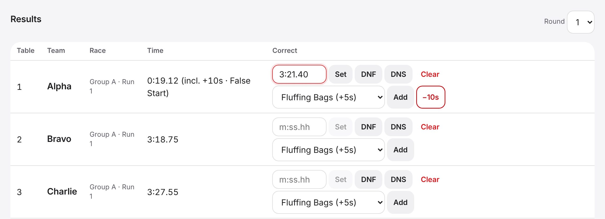

**Correcting an earlier round:** once a later round has been opened, the app asks **"Change an earlier round?"**
- **A round keeps its line-up once it's opened.** The app saves who races where when you open each round, and which teams are in each bracket when you open the first bracket round. A correction never changes those.
- **The dialog names any opened round that keeps a line-up the corrected results no longer match**, for example "Round 3 was opened with its original line-up and keeps it. The corrected results will not match who raced there." If no round is named and the brackets aren't affected, it says "No line-ups are affected."
- Press **Change anyway** to go ahead. Seeding ranks, places and standings are worked out again from the corrected results, and rounds you haven't opened yet are built from them.
- **Bracket membership is final once the first bracket round is opened.** Every bracket round after that, including ones not opened yet, is built from those brackets, not re-seeded. A team stays in its bracket even if its corrected seed would now put it in a different one.
- **If a correction changes the seeding the brackets were set from**, the dialog also says, in bold, "Brackets were set when the first bracket round opened. Teams stay in those brackets, even if this changes their seeding."
- You can correct an earlier round even while the current round is open or running: the current round's line-up doesn't change.
- If a correction creates a tie in an earlier round, the round that's open or running carries on as it is. Decide the tie before you open the next round.

### Time penalties

Penalties are switched **off** for a new event. The **Time penalties** switch in **Settings**, in the event's panel, turns them on or off for the whole event.
- **It takes effect at once**, even mid-race: the penalty buttons appear or disappear on every referee tablet.
- **Turning it off doesn't remove** penalties already given.
- **You can still add or remove penalties** in Results while it's off.

How penalties count:
- A referee's penalty tap adds **no time** by itself; you set the length when you review it (see below). Taps **stack**: three taps are three penalties to review.
- A team's **official time** is its finish time plus its penalties. The official time decides places, head-to-heads, ties and seeding.

### Penalty review

A referee's penalty **adds no time**; it flags the team as **pending: under review** (that label appears beside the team's time for everyone, and as "under review" on the projector) until you decide it. The referee can send a note for each penalty: the closest reason from the list, plus a short comment. They can do this as soon as they tap that team's finish button, so a note often arrives while the race is still running.

Pending penalties appear in the **Penalties to review** panel on the Race Control page ("Round N · flagged by the referee") as soon as the referee taps them. The referee's pick and note show up there when they send it. For each one:

1. Read the referee's pick and note. A note isn't required, so you can decide without one.
2. Choose the official reason from the penalty list. The referee's pick is pre-selected.
3. Then decide:
   - **Approve with a time reason:** the penalty becomes that reason's time (for example, +10s for "False Start").
   - **Approve with a DQ reason:** the team is disqualified from that race. It ranks like a DNF and shows as **DQ**.
   - **Reject:** the penalty is removed and the results update.

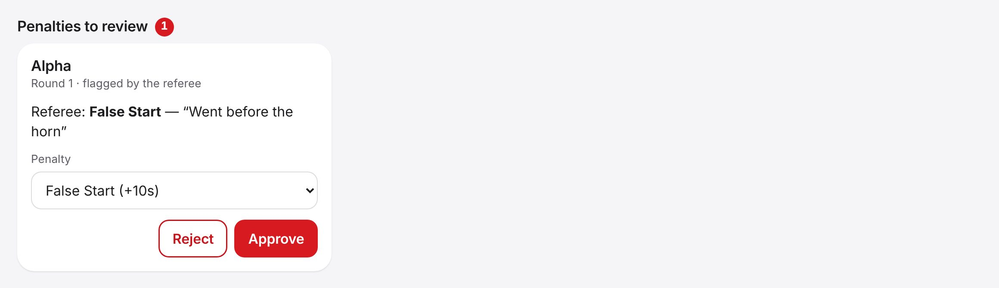

**You can't open the next round while any penalty is still pending.** The big button stays greyed out and the status line reads "Waiting on *N* penalties to be reviewed".

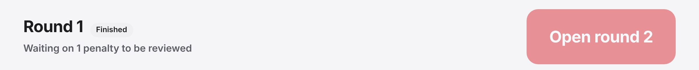

Approved reasons are shown to everyone:
- **On phones**, for example `3:46.20 (incl. +10s · False Start)` or `DQ · Unsportsmanlike conduct` (if you add a DQ reason to the list).
- **On the projector**, just `+10s` or `DQ`.
- **In the CSV and JSON exports**, together with the referees' notes.

To change a decision on an earlier round after a later round has opened, you'll get the same **"Change an earlier round?"** confirmation as for times.

### Fairness

The app watches for patterns that could mean one team is being helped or held back, and lists them in the **Fairness** panel on the Race Control page. A red number beside **Race Control** in the menu shows how many are waiting.

**These are prompts to take a look, not proof of anything.** Most have an innocent explanation. A warning never stops you opening, starting or finishing a round, and nobody outside race control sees them: not referees, participants, the projector or Companion.

What each one means:

| Warning | When you see it |
|---|---|
| **Very fast time** | A team's time is at least 30 seconds faster than the fastest time in the event before it. Check it wasn't a mistaken tap. |
| **One referee's teams keep doing well** | Over at least 6 bracket races, the teams one referee judged finished better than their seeding suggested far more often than worse. |
| **Same referee, same team** | A referee has the same team for the third time, or two rounds running. It can't always be avoided with few referees, and a swap can cause it. |
| **Same referee, same team penalised again** | A referee has given penalties to the same team in two or more rounds. |
| **Unusual number of penalties** | After three rounds: a referee has given far more penalties than the others, or none when the others have given several. |
| **Close finish** | Two teams in the same race, both judged by one referee, finished within half a second of each other. |
| **Undo changed the winner** | A referee took back a finish tap, and with the first tap a different team would have won that race. |
| **Final judged by one referee** | A bracket's deciding race or the Grand Championship had both teams at one referee, because no referee was spare. |

Each warning says which round and referee it's about ("Whole event" for the two that look at the whole event) and gives the details in a sentence. Warnings update by themselves: if you correct a result and the pattern no longer holds, the warning goes away.

To dismiss one once you've looked into it:

1. Press **Dismiss** on the warning.
2. Type a short **Note** saying what you checked (required, up to 200 characters).
3. Press **Save**.

The warning moves to the **Dismissed** list at the bottom of the panel, with your note, who dismissed it and when. Click **Dismissed** to open the list. Dismissals are recorded in the **Log** and in the [fairness report](#fairness-report).

With **Rotate referees** off, the panel only appears when there's a warning to show.

Once the event has ended, warnings can't be dismissed any more. They're all still in the fairness report.

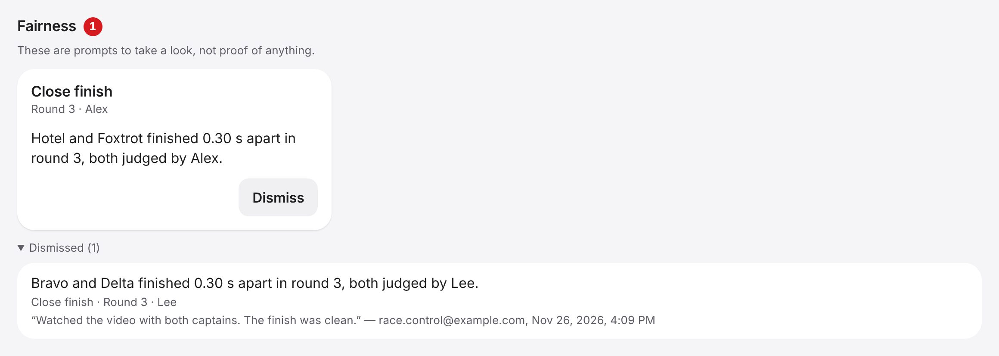

### Ties

If two or more teams in a race have exactly the same official time (to the hundredth of a second), a **Ties to decide** panel appears:

1. Use the **↑** and **↓** arrows to put the teams in finishing order.
2. Press **Decide**.

If one race has more than one tie (say two pairs with the same times), each tied group gets its own card. Decide them one at a time; each keeps its own order.

The next round can't be opened until every tie is decided.

### Rename a team

Spotted a misspelling on the projector? Go to **Teams**, press **Rename** on the team's row, type the new name and press **Save**. Race control can do this at any time during the event.

### Projector control

The projector changes screens by itself. To show a particular screen, use the **Projector** menu on the Race Control page and choose **welcome**, **tables**, **clock**, **seeding results**, **brackets**, **standings** or **champion**. The projector stays on that screen until you choose **Projector: automatic** again. The automatic option shows which screen it would pick.

### Show the champion

When the last round is finished and every penalty has been decided (until then the button is greyed out and the status line says what it's waiting for):

1. Press **Show champion** (the big button on the Race Control page).
2. Enter or confirm the number of bags packed, then press **Show**.
3. The projector **and every participant's phone** switch to the champion screen: the Grand Champion, the bag total and the final standings by category. If there's no Grand Championship, it shows each category's winner instead.

While the champion is showing, the big button reads **Hide champion**. Pressing it returns everyone to the normal screens. You can change the bag number at any time.

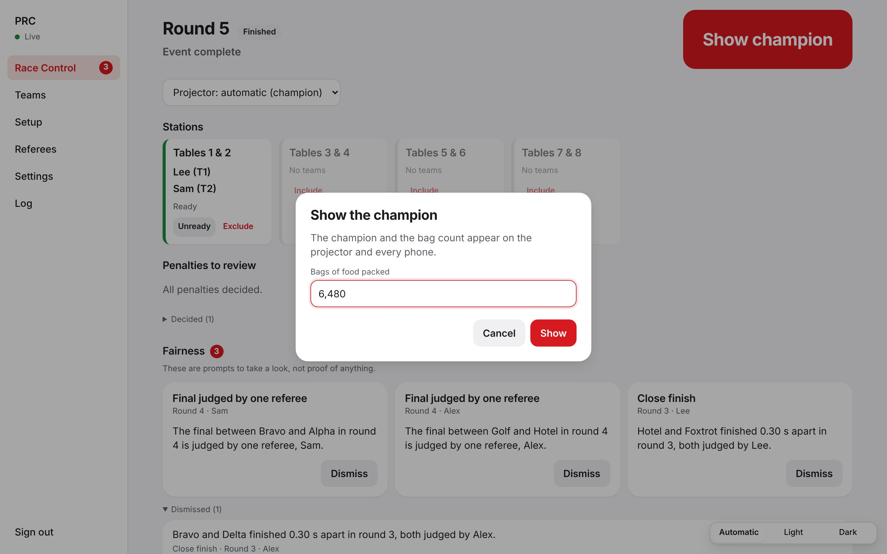

### Referees and Log

- **Referees:** pair or revoke referee tablets (see [Pair the referee tablets](#7-pair-the-referee-tablets)). With Rotate referees on, it also shows each referee's tables this round.
- **Log:** the latest 50 changes, newest first, with who made each one. Every tap, penalty, undo, correction, override, tie decision and round change is recorded.

---

## Referees

You'll use a tablet or phone paired to your station. The top of the screen shows your **table numbers**, the **round**, and a dot showing your connection. If referees rotate at your event, the table numbers can change from round to round (see [Moving between rounds](#moving-between-rounds)).

### Pairing

1. Race control shows a QR code for your station (in **Referees**).
2. Scan it with your device's camera. The referee page asks for **Your name**.
3. Type your name (up to 40 characters) and press **Start**. If the connection drops, the form stays: check the connection and press **Start** again. Your name shows in race control's Referees list and in the log next to what you do.

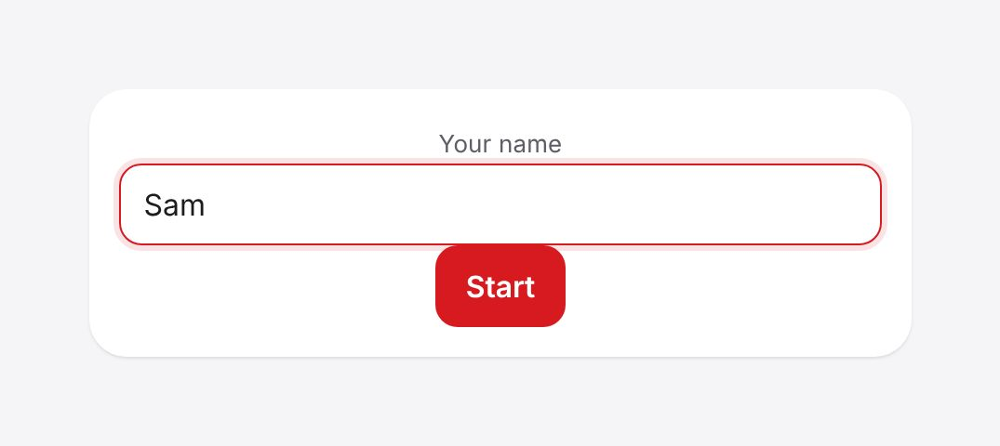

4. **Keep your screen on.** If your phone or tablet locks during a race, unlocking it delays your tap and adds time to your team's result. The page shows where to turn off auto-lock:
   - iPhone or iPad: Settings, then Display & Brightness, then Auto-Lock, then Never. Turn off Low Power Mode.
   - Android: Settings, then Display, then Screen timeout, then the longest option. Turn off Battery Saver.

   Turn it off, tick **I've turned off auto-lock on this device** and press **Continue**. Your tables appear. You see this once each time you pair.

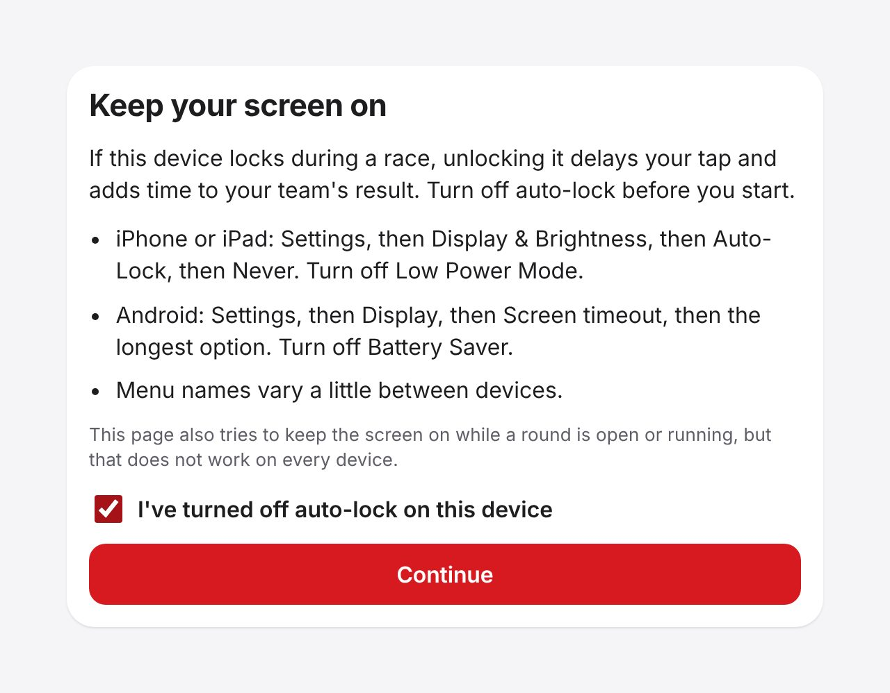

If you see **"Scan the station QR code"**, your device isn't paired (or was disconnected). Ask race control for a new code.

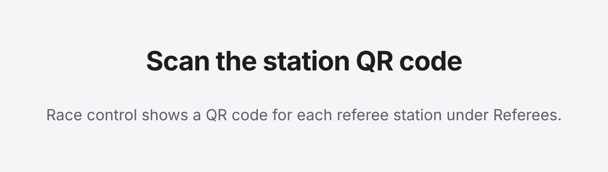

### Moving between rounds

When race control has switched on **Rotate referees**, you may be sent to different tables each round, so that nobody judges the same team again and again. The app works out where everyone goes; you don't choose.

- **If you need to move**, the screen shows a large notice when the round opens, for example **"Round 5: go to Tables 7 & 8"**. Go to those tables, then press **I'm there**. Your teams and the Ready buttons appear after that.
- **If you stay where you are**, there's no notice. Carry on with Ready as usual.
- **The top of the screen always shows the tables you have this round.** Only those teams are on your screen, and only you can tap for them.
- **If race control swaps you with another referee** before the start, the notice comes back with your new tables. Move, then press **I'm there** again.
- **"No tables this round"** means there are more referees than tables in use this round, so you have a round off. Stay nearby: race control may still need you. Your tables for the next round appear when it opens.
- **In a final** you may be given just one of the two tables at a station, with another referee on the other one. Each of you sees and taps only your own team.

If the race starts before you pressed **I'm there**, the finish buttons appear anyway, so you can't miss a tap.

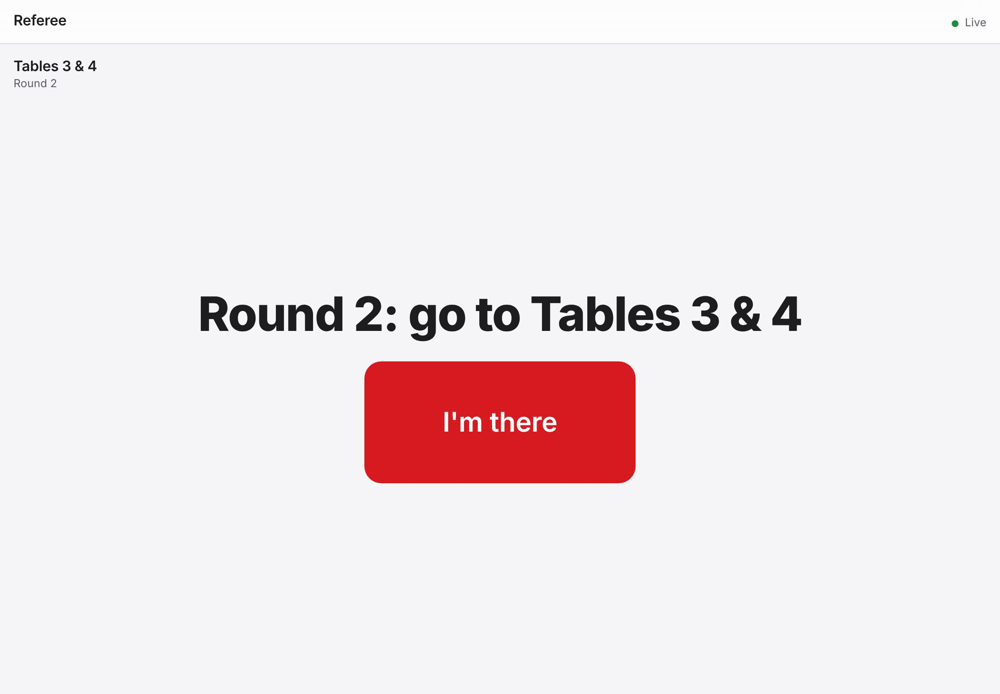

### Before the race: Ready

1. When race control opens a round, your teams and their tables appear.
2. Check each team is at the right table and set up.
3. Press **Ready** for each table once its team is ready. With two teams you get two Ready buttons, each showing its table and team ("Table 1 · Alpha"); with one team, one big Ready button. A pressed table shows **Ready ✓** while the other button stays there for you to press. When all your tables are ready you'll see **Ready ✓** and "Waiting for the start".

The projector shows a green dot next to each team whose table you've readied, so the room can see who the start is waiting on.

Once pressed, Ready stays on. If you pressed it by mistake, ask race control to clear it.

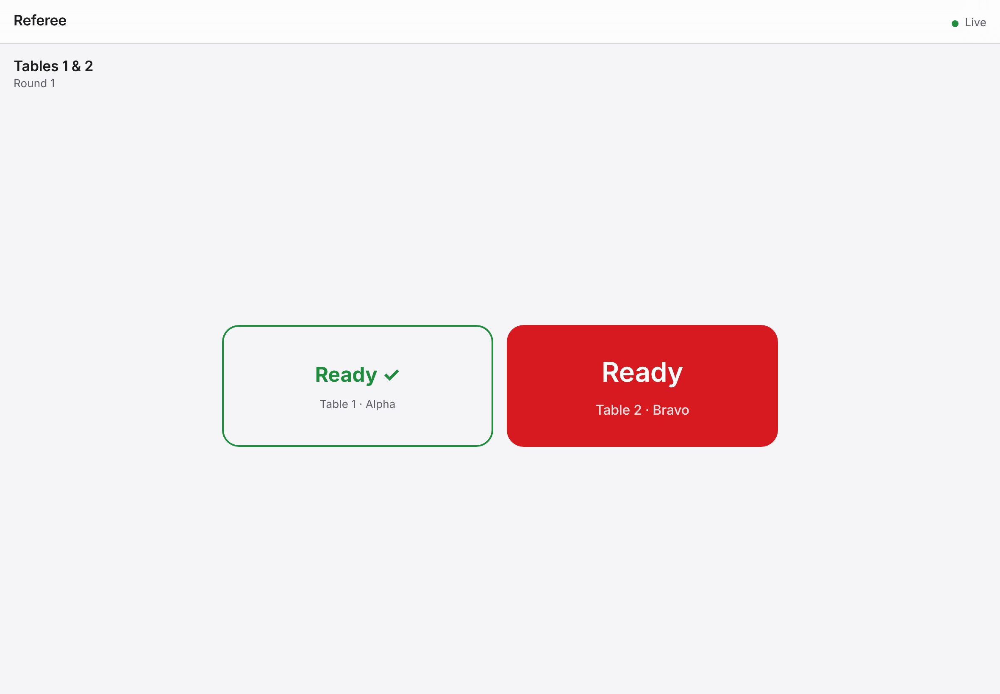

If none of your tables has a team this round, you'll see "No teams at your tables this round". Stand by for the next one.

### During the race: tap finishes

When the race starts, the clock runs and there's one large button per team.
- **Tap a team's button the moment it finishes.** The button then shows the team's time.
- **Each team gets one time.** Once tapped, its button stops responding.
- **The screen stays on** while a round is open or running, on devices that support it.

If the buttons are greyed out with **"Syncing clock…"**, wait a moment: the tablet is lining its clock up with the server.

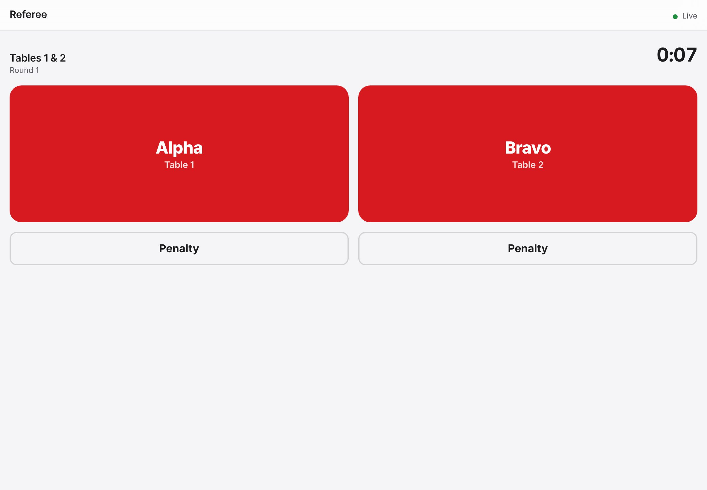

### Undo

Every tap gets its own bar just below the team buttons (above any penalty notes), newest on top, for example "**Alpha finished**" or "**Penalty for Alpha**", each with an **Undo** button and a shrinking countdown (about 10 seconds by default). Tapping two teams in a row gives two bars.
- **Press Undo before its bar runs out** to take that tap back.
- **Taps sent after a dropout** get their bar too, once they reach the server. The countdown runs from the moment the tap was recorded.
- **If Undo can't be sent,** you'll see "Could not undo — not connected. Try again." and the bar stays until its time runs out.
- **After that, or once the round is finished,** only race control can change it. If you press Undo too late, a red message says "Too late to undo; ask race control." (or "The race is over; ask race control." once the round has finished).
- **If the server refuses a tap that was waiting to send** (for example the team already has a result), a red message says "The saved tap for Alpha in round 3 was refused", with the reason. You see it even if the round changed while the tap was being sent. Tell race control if the time looks wrong.
- **If a red message says "The server could not process that. Try again."**, the tap is not lost: it stays saved on the tablet and is sent again automatically within a few seconds. Tell race control if the message keeps coming back.

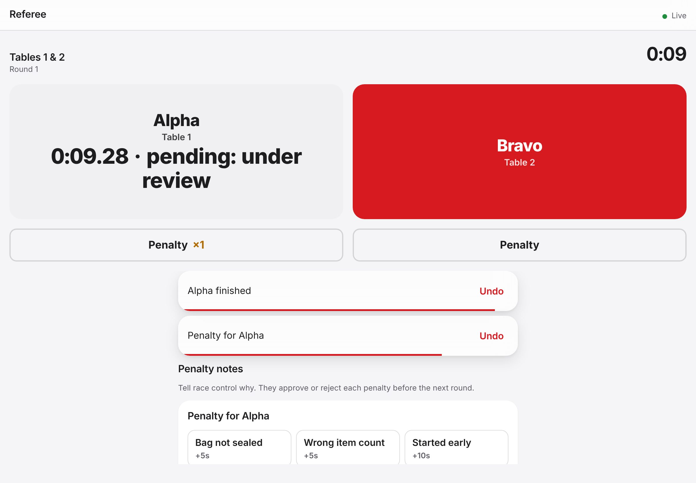

### Only one referee tab

The referee page runs in one browser tab per tablet, so two tabs never keep separate lists of saved taps. If you open it a second time, the new tab says **"The referee page is already open in another tab on this tablet"** with a **Use this tab instead** button. Press it to make this tab the live one; the other tab then shows the same message, with its own button to take it back. Browsers without this feature behave as before and allow several tabs.

### Penalty button

When race control has switched penalties on, each team has a smaller **Penalty** button under its finish button. It adds no time; race control sets the length afterwards.

- **When:** any time from the start until the race finishes, before or after the team's finish tap. Once every team has a result, the race finishes by itself once the auto-finish delay has passed since the last tap, and each penalty tap or penalty note starts the auto-finish delay again.
- **Stacking:** each tap adds one penalty. The button shows how many, for example **×2**.
- **Undo:** each penalty tap has its own **Undo**, just like a finish tap, unless race control has already decided that penalty.
- **Don't mix them up:** the penalty button is deliberately smaller, and it's an outlined button rather than a solid one like the finish button.

### Penalty notes

You don't have to wait for the round to finish to say why you gave a penalty. A **Penalty notes** card appears below the team buttons and the Undo bars for each penalty you gave that still needs review:
- **During the race:** as soon as you tap the team's finish button (or race control marks the team DNF, DNS or DQ). If you give a penalty after the team finished, its card appears straight away. The **Undo** bars still work as usual: if you undo the finish, the card goes away (with anything you typed) until you tap the finish again; if you undo the penalty, its card goes away.
- **After the race:** every penalty you gave that still needs review has a card.

On each card:
1. Pick the closest reason from the list.
2. Add a short note if it helps (optional).
3. Press **Send to race control**. The card then shows **Sent ✓**.

If the round finishes while you're filling in a card, what you've picked and typed stays; just press **Send**. Sending a note restarts the auto-finish delay, which gives you time for the next one.

Your note goes only to race control, who makes the final decision.

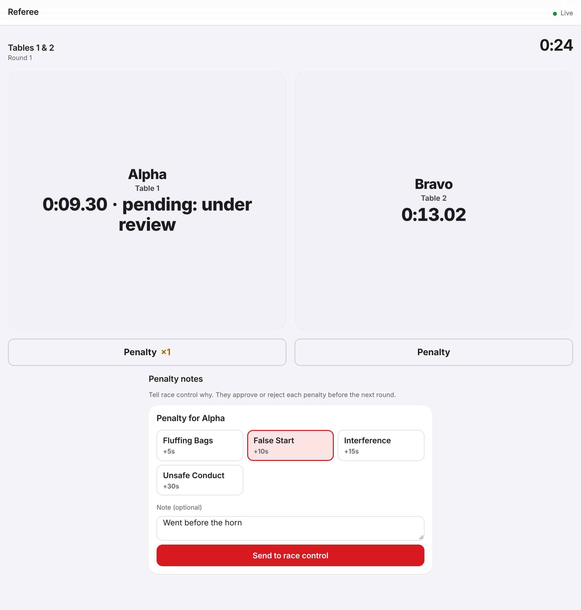

### If the Wi-Fi drops

Keep tapping. The tablet saves your taps with their exact times and sends them automatically when the connection is back, so the results aren't affected. A notice shows how many taps are waiting to send. Leave the page open until it disappears.

---

## Participants

Anyone can follow the event on a phone at **r2f.weiss-audio.com**. You don't need to sign in. Scan the QR code on the projector to get there.

**Find your team:**
1. Type part of your team name into **Find your team**.
2. Tap your team in the list.

Your phone remembers your team, so next time it opens straight to it. Tap **Not you?** to choose a different team.

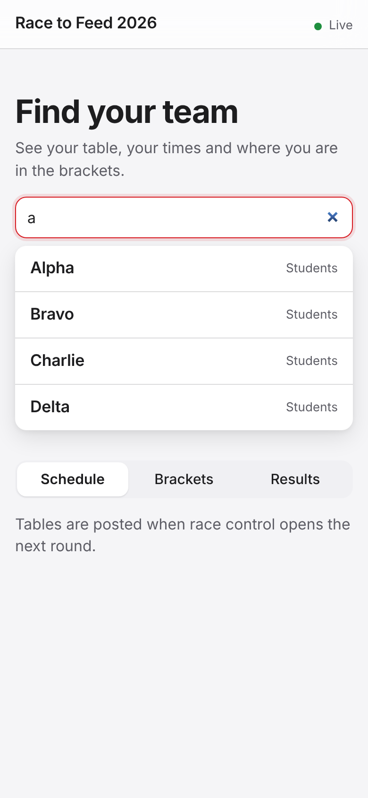
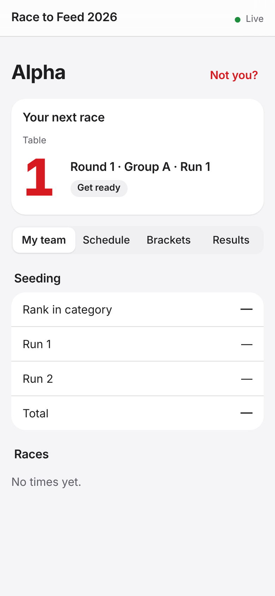

**Your next race** is at the top:
- **Before a round opens:** it says "Round *N* — your table appears here when it opens."
- **When the round opens:** it shows your **table number** in large type, the round, the race, and who you're racing against.
- **Status:** **Get ready**, **Racing now** or **Finished**.
- **After the last round:** "All rounds are done. Thanks for racing!"

**The tabs below:**
- **My team:** your seeding rank in your category, your total seeding time, and your time and place in each race.
- **Schedule:** every team's table for the current round, with yours highlighted.
- **Brackets:** every category's brackets, updating live. Switch between **Cards** and **Diagram**.
- **Results:** the latest round's results.

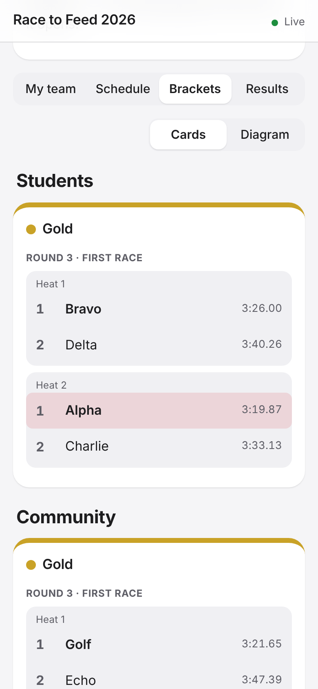

Times include penalties. For example, `3:46.20 (incl. +10s · False Start)` means the time already includes a 10-second penalty. **pending: under review** after a time means a referee has flagged the team and race control hasn't decided yet; the time may still change. **DQ** means the team was disqualified from that race.

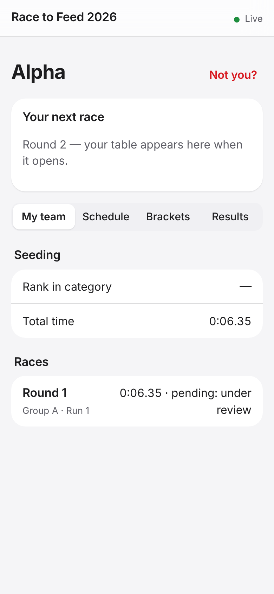
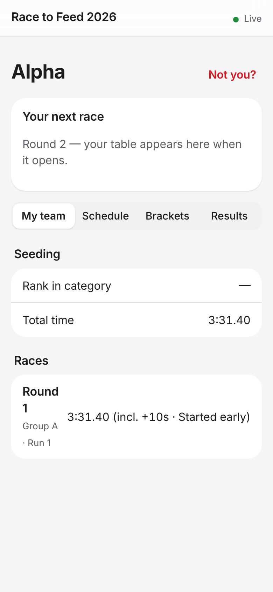

When race control shows the champion, a champion card appears at the top of every phone. It shows the Grand Champion (or each category's winner if there's no Grand Championship), the bags packed and the final standings, with your team highlighted. The tabs stay available below. After the event ends, phones also show **Event complete**.

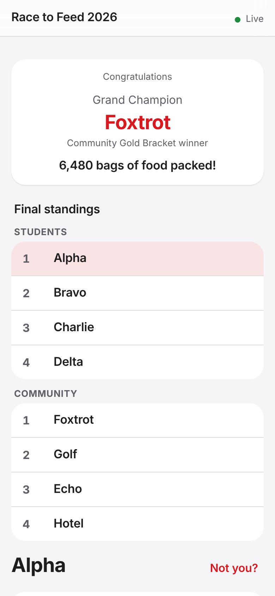

---

## Projector

Open **r2f.weiss-audio.com/projector** on the computer connected to the projector and make the browser full screen. The mouse pointer hides itself after 3 seconds.

The projector follows the event by itself:

| When | It shows |
|---|---|
| Before the first round | **Welcome**: the event name and a QR code to the participant site |
| A round is open | **Tables**: "Go to your table", every team's table number, and the QR code. A green dot next to a team's name means its table is ready (the referee pressed **Ready**); a red dot means the start is still waiting on that table |
| A race is running | **Clock**: a big master clock. As soon as the first team is in, the clock shrinks to the top and the list of teams appears under **Preliminary times** (see below) |
| After a seeding round | **Seeding results** by category, coloured by bracket tier |
| After a bracket round | **Brackets**, cycling through the categories |
| After the Grand Championship, or when race control shows the champion | **Champion**: the Grand Champion and the bags packed. While a penalty is still pending review it stays on **Brackets**, and switches to the champion once every penalty is decided |

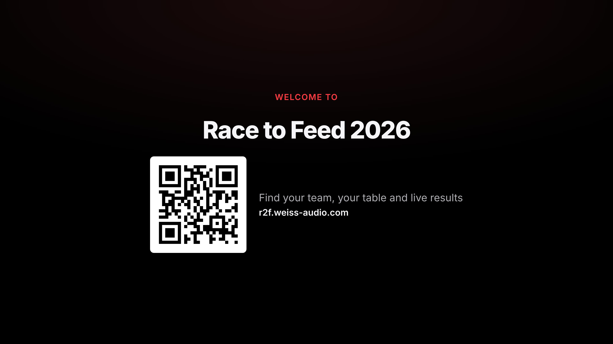
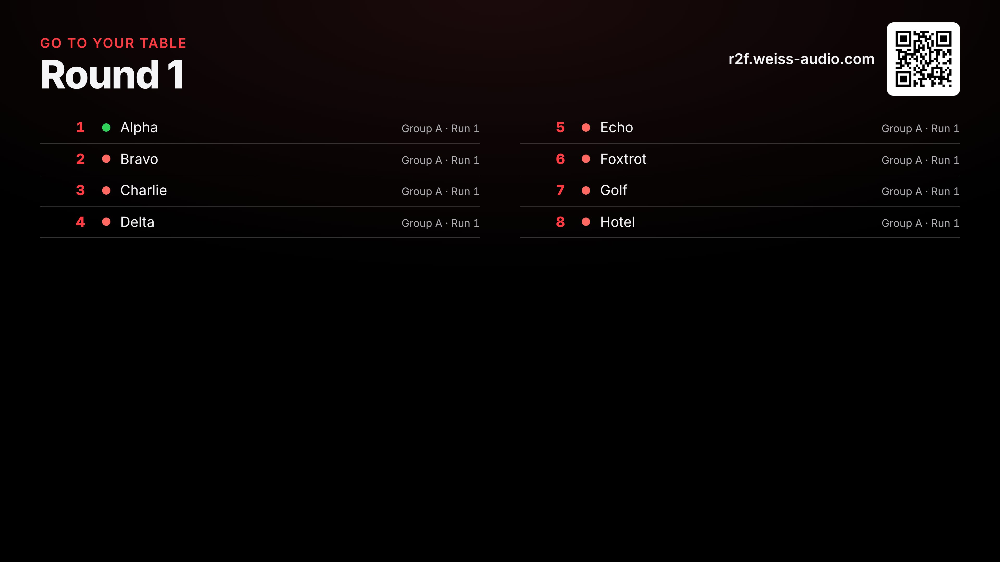

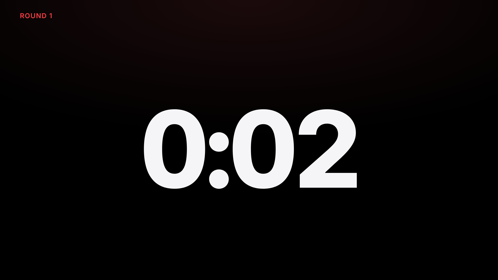
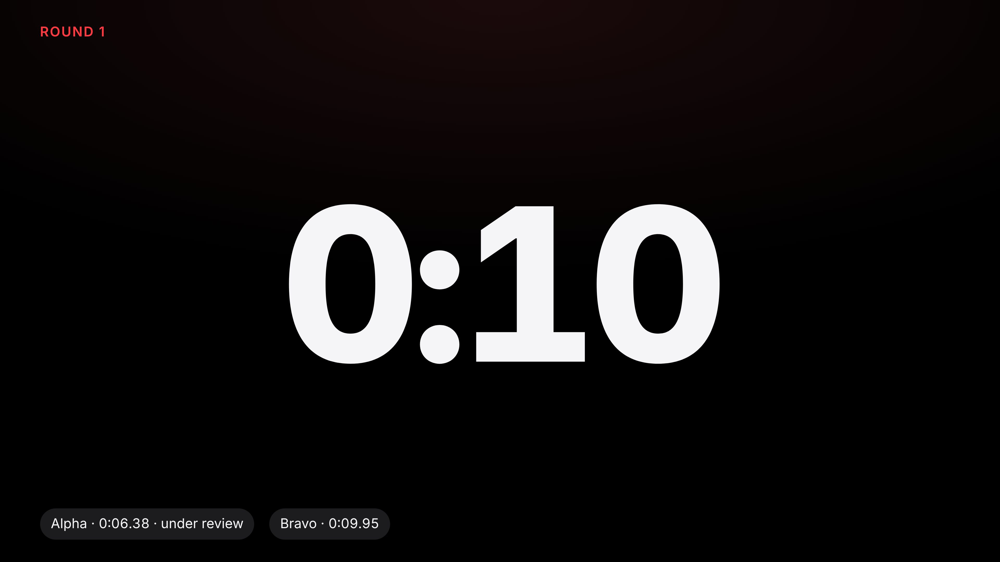

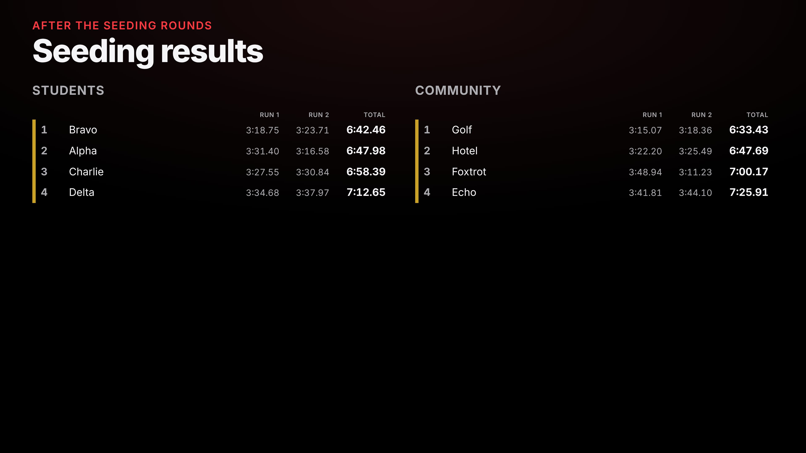
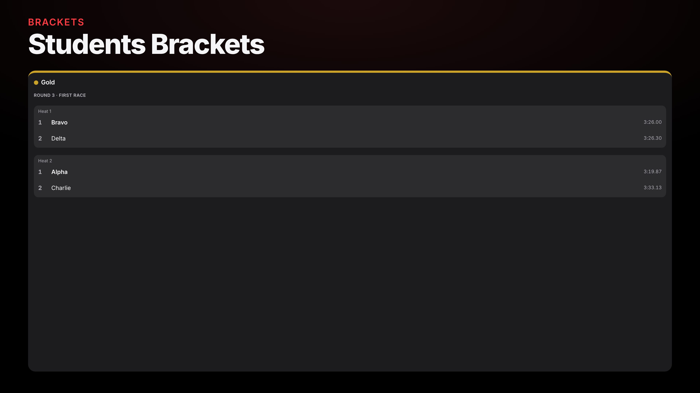

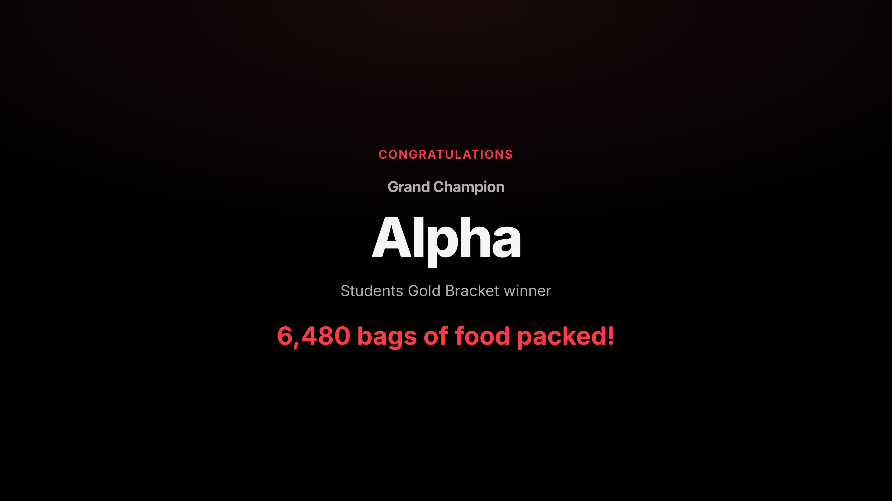

**During the race**, once the first team is in, every team of the round is listed under the clock in two columns (down the first column, then the second):
- The **red number is the finishing position** (1 for the fastest time so far). Teams still racing, and teams marked DNF, DNS or DQ, have no number. Two teams with exactly the same time share a position.
- The team's **table** follows its name in grey, for example "Alpha (T1)".
- Finished teams first, in the order they finished (fastest time first), each with a checkered-flag marker and its time: `3:41.20`, `3:46.20 (+5s)` with an approved penalty, `under review` while a penalty is pending. Then teams marked **DNF** (or **DQ**), then **DNS**.
- Then the teams still racing, by table number, with a green dot and their race label.

With fewer teams in a round, the team list on the **Tables** and **Clock** screens uses bigger text to fill the screen, as big as the longest team name allows on one line. A very long name may end in "…" on a full 26-table round.

The times are preliminary until race control finishes the round. The list stays up for the rest of the race, even if a finish is undone.

Race control can pin any screen, including **standings**, from the console (see [Projector control](#projector-control)). If the projector seems stuck on one screen, check whether it's been pinned.

### Using the projector in OBS

To put your own image or moving background behind the projector, add a **Browser** source in OBS with the address **r2f.weiss-audio.com/projector/?bg=transparent** (copy it from **Setup → Screen links**), sized 1920 × 1080, and place it above your background in the source list. The page then has no background of its own, and the text gets a soft dark shadow so it stays readable. Dark or calm backgrounds work best: the text is white, so a bright or busy background makes names hard to read.

---

## Bitfocus Companion (Start and Finish buttons)

Race control can start and finish races from Stream Deck buttons through Bitfocus Companion. The buttons follow exactly the same rules as the console's **Start** and **Finish now**: a refused press changes nothing.

**What you need:**
- A Companion key, made in **Settings → Companion keys** (see [Companion keys](#6-companion-keys)).
- The computer running Companion must have internet access.

### For whoever sets up the buttons

Each button sends a web request:

- **Address:** `https://r2f.weiss-audio.com/api/command`
- **Method:** `POST`
- **Headers:**
  - `Authorization: Bearer YOUR-KEY` (paste the key in place of `YOUR-KEY`)
  - `Content-Type: application/json`
- **Body:** depends on the button:

| Button | Body |
|---|---|
| Start race | `{"cmd": {"type": "startRace"}}` |
| Race finished | `{"cmd": {"type": "finishRace"}}` |
| Pin a projector screen (optional) | `{"cmd": {"type": "pinProjector", "screen": "champion"}}` |
| Projector back to automatic (optional) | `{"cmd": {"type": "pinProjector", "screen": null}}` |

The projector screens you can pin are `welcome`, `tables`, `clock`, `seeding-results`, `brackets`, `standings` and `champion`.

**What comes back:**
- **It worked:** status `200` with `"ok": true`.
- **It was refused:** status `400` with a readable `message`, for example "2 station(s) not ready." or "3 team(s) have no result."
- **The key is wrong or revoked:** status `401`.

A Companion key can do only these things. It can't change results or setup.

---

## Ending, reopening and deleting an event

### End the event

When the event is over:

1. Go to **Settings**. The **Events** panel is at the top; click it to open it.
2. Press **End event** on the active event.
3. Confirm. The confirmation warns you if some rounds haven't been raced, or if any penalty is still waiting for a decision (decide those first, or they stay "under review" in the final results).

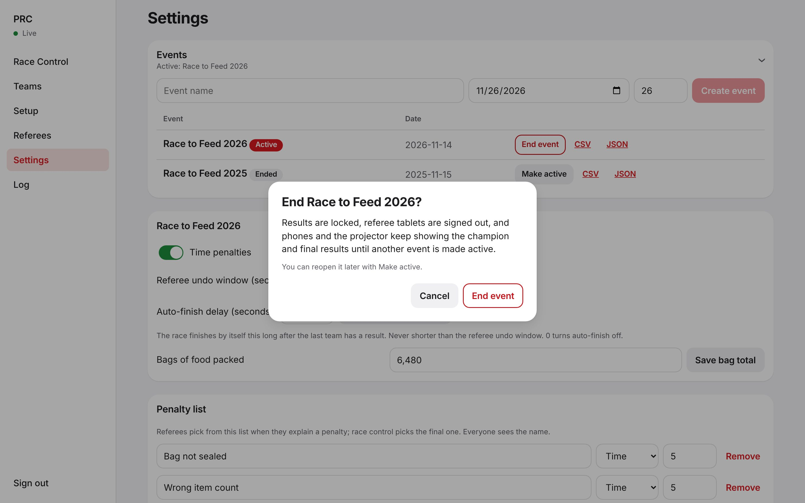

When an event ends:
- It's marked **Ended** and is no longer active.
- Its results are locked: no further changes are accepted.
- All referee tablets are signed out and their pairings cancelled.
- **Phones and the projector keep showing the champion and final results** until someone activates another event.
- The **CSV**, **JSON** and **Fairness report** downloads keep working.

### Fairness report

Next to **CSV** and **JSON** on every event's row in **Settings → Events** there's a third download, **Fairness report**. You can download it at any time, during the event or after it. It's one spreadsheet file (CSV) with three parts:

1. **Warnings:** every [Fairness](#fairness) warning, whether it's open or dismissed, and for a dismissed one the note, who dismissed it and when.
2. **Race control edits:** every result or penalty that race control entered, changed or removed by hand, with the time and who did it. Referees' own taps aren't listed.
3. **Referee assignments:** one row per referee per round, with their station, tables and teams. Rounds opened with Rotate referees off have no rows.

### Reopen an event

On the ended event's row in **Settings → Events**, press **Make active** and confirm. Then:
- Referee tablets must be **paired again**.
- If a race was counting down to auto-finish when the event ended, the auto-finish delay starts again from the moment you reopen it. The same happens if you make another event active mid-countdown and then switch back.
- If the event was ended before its last round, the champion screen is taken down automatically. If it was ended after the last round, the champion stays up; race control can press **Hide champion** at any time.

### Delete an event

Use this to clear out test events, or old events you no longer need. **Deleting cannot be undone**: the event, its teams, results and log are gone for good.

1. Go to **Settings** and open the **Events** panel.
2. **Download a copy first** if you might want one: press **CSV**, **JSON** or **Fairness report** on the event's row (the same links are in the confirmation too).
3. Press **Delete** on the event's row. Every event except the active one has it; to delete the active event, end it first (or make another event active).
4. In the confirmation, type the event's name exactly as it's shown (capitals and spaces count; spaces at the start or end don't). **Delete event** only becomes available once the name matches.
5. Press **Delete event**. The event disappears from the list.

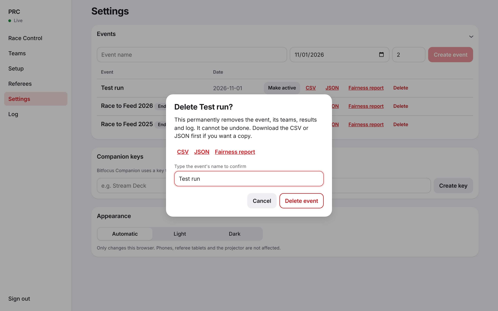

If phones and the projector were showing the deleted event (because it was the last one to end), they switch to the event that ended before it, or to the "no event" screen if there isn't one. The server keeps a short record of who deleted which event and when, but nothing else from the event.

---

## Troubleshooting and FAQ

**The referee tablet says "Scan the station QR code".**
The tablet isn't paired, or its pairing ended. That happens when it's revoked, when another event is made active, or when the event is ended. Ask race control for a new code in **Referees**.

**"This pairing code is invalid or already used."**
Codes work once and last 10 minutes. Make a new one with **Pair tablet**.

**The referee's buttons are grey and say "Syncing clock…".**
Wait a few seconds; the tablet is lining up its clock with the server. If it stays like that, check the tablet's Wi-Fi.

**A referee's phone keeps locking (the screen goes dark during a round).**
Unlocking it delays the tap and adds time to the team's result. Turn off auto-lock: on an iPhone or iPad, Settings, then Display & Brightness, then Auto-Lock, then Never, and turn off Low Power Mode; on Android, Settings, then Display, then Screen timeout, then the longest option, and turn off Battery Saver. The referee page tries to keep the screen on during a round, but that doesn't work on every device.

**A referee says "*N* taps waiting to send".**
The connection dropped. The taps are saved with their real times and will send by themselves. Keep the page open. Race control sees those teams under **Waiting on *N* teams** until the taps arrive.

**The referee page says "The referee page is already open in another tab on this tablet".**
Only one tab can run the referee page. Close the other tab, or press **Use this tab instead** here.

**Start is greyed out: "Waiting on *N* referees to be ready" (or "*N* tables").**
Look at the **Stations** panel. Ask those referees to press Ready, or use **Ready** or **Exclude** on their station yourself.

**Finish now is greyed out: "Racing — waiting on *N* teams".**
Use the **Waiting on *N* teams** panel: wait for the referee's tap, press **Finish** to stop that team's clock yourself, enter a time in **Results**, or mark the team **DNF** or **DNS**.

**Open round N is greyed out or refused.**
Read the status line or the message under the button: lock the setup, finish the current round, decide pending penalties, decide a tie, or enter a result for a team that has none in a finished round (choose that round in **Results**, then enter a time or mark DNF or DNS). See [Open a round](#open-a-round).

**A referee's tablet says "No tables this round".**
There are more referees than stations in use this round, so that referee has a round off; or they paired after the round opened and their station already had a referee. They get tables when the next round opens. To use them now, while the round is still open, press **Swap…** next to another referee's name in the **Stations** panel and choose them. See [Swap two referees](#swap-two-referees).

**A referee's tablet says "Round N: go to Tables …".**
Referees rotate at this event. The referee goes to those tables and presses **I'm there**; the Ready buttons appear after that. See [Moving between rounds](#moving-between-rounds).

**A station shows "No referee".**
Fewer referees are paired than there are stations with teams. Pair another tablet for that station in **Referees** (it takes over straight away if the round is open or running), or run the station yourself: **Ready** on its card, then **Finish**, **DNF** or **DNS** in the **Waiting on *N* teams** panel.

**I turned Rotate referees on (or off) and nothing moved.**
The switch takes effect from the next round you open. The round that's open or running keeps its referees.

**There's a red number next to Race Control.**
That many [Fairness](#fairness) warnings are waiting. They're prompts to take a look and never block anything. Dismiss each with a short note once you've checked it.

**A Fairness warning disappeared by itself.**
A result was corrected and the pattern no longer holds. Nothing else is needed.

**A referee's tablet stops working during a race.**
On the **Race Control** page, press **Finish** next to each of that referee's teams in the **Waiting on *N* teams** panel as the team finishes. It stops the team's clock at that moment, just as the referee's tap would.

**A referee missed a penalty and the race is still running.**
On the **Race Control** page, find the team in **Results**, pick a reason and press **Add**. It counts straight away. See [Enter or correct results](#enter-or-correct-results).

**The import says a team name "is 41 characters; team names can be at most 35".**
Shorten that name in your list (for example "High School" to "HS") and import again. Nothing is imported until every problem in the list is fixed.

**I need the address of a screen (projector, participants, OBS).**
Go to **Setup** and scroll to **Screen links**. Press **Copy** next to the one you need.

**A referee tapped the wrong team or too early.**
Within the undo window, the referee presses **Undo**. After that, race control fixes it in **Results**: enter the right time, or press **Clear**.

**A team's name is misspelled on the projector.**
**Teams → Rename**.

**The projector is stuck on one screen.**
It's probably pinned. On the **Race Control** page, set the projector menu back to **Projector: automatic**.

**The console says "You are not signed in. Reload this page to sign in."**
Your sign-in ended (it lasts 14 days) or you pressed **Sign out**. Press **Reload**, then sign in with your email and the code.

**An export link shows "cross_site".**
This can happen when you click an export link straight after signing in again. Click the link again from the console.

**Deleting an event says "End this event or make another one active before deleting it."**
You can't delete the active event. End it first (or make another event active), then press **Delete**. See [Delete an event](#delete-an-event).

**Deleting an event says "Type the event's name exactly to delete it."**
The name you typed doesn't match. Type it exactly as it appears in the list, with the same capitals and spaces.

**Deleting an event says "No such event."**
It has already been deleted, perhaps from another laptop. Close the confirmation; the list updates when you reload Settings.

**I don't get the email with the code, or Cloudflare says I'm not allowed.**
Check the spam folder and that you typed the address on the allow list. Ask whoever manages the Cloudflare account to check the list (see [Who can sign in](#5-who-can-sign-in)).

**The console says "Console sign-in is not set up."**
The app's Cloudflare Access settings are missing. Tell whoever deployed the app. Meanwhile, use the emergency sign-in below.

**Cloudflare or email is down and nobody can sign in (emergency sign-in).**
Open `/emergency` (for example `r2f.weiss-audio.com/emergency`). It is not linked from any page. Type the emergency password and press **Sign in**. You get the same console for 12 hours; the Log shows your actions as "emergency sign-in". Whoever deployed the app holds the emergency password. If the page says **"Emergency sign-in is not enabled."**, no emergency password has been set.

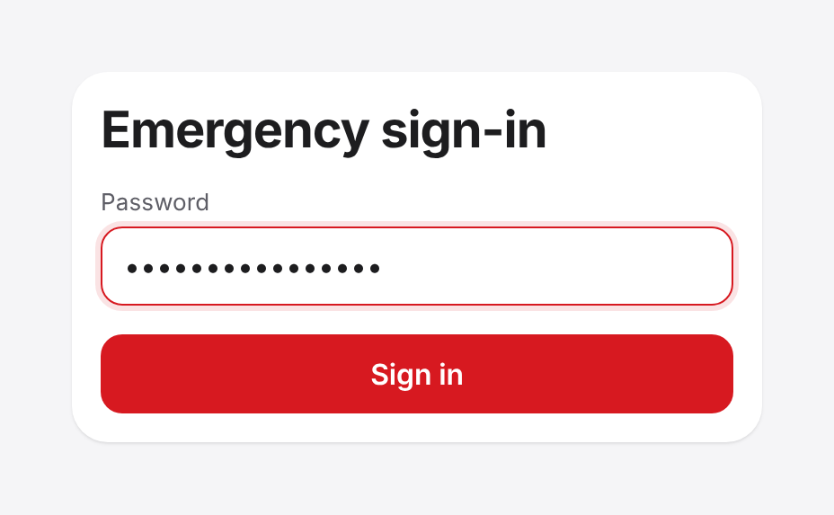

**"Too many attempts. Wait five minutes and try again."**
After 5 wrong emergency passwords in 5 minutes, emergency sign-in pauses for that network. Wait, then try again with the right password.

**"Setup is locked; unlock it before changing teams, groups or brackets."**
**Unlock setup** works only before the first round is opened. After that, only renaming teams, settings, the penalty list and the bag total can change.

**A tablet was lost.**
Go to **Referees** and press **Revoke** next to it. It's disconnected immediately. Pair a replacement.

**A phone shows the wrong team.**
Tap **Not you?** and search again.

**The venue internet goes down.**
Referee taps are saved and sent when it's back, but starting and finishing need the internet. Keep a phone hotspot ready as a backup for race control and the Companion computer.
